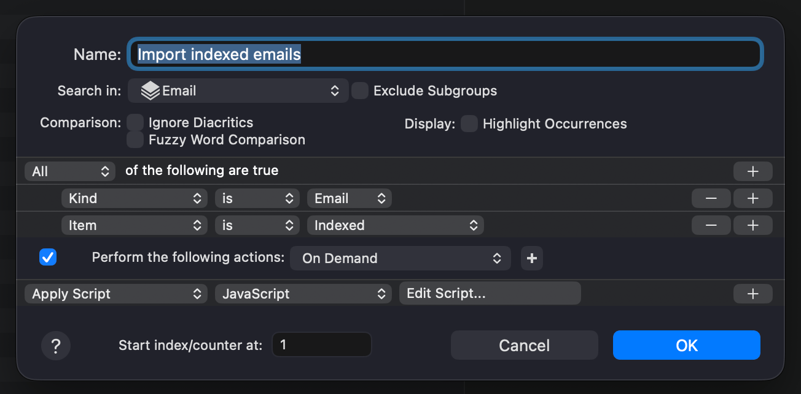

# MailMate → DEVONthink email archive

This set up exports your selected emails from MailMate, creates a folder structure based off mailboxes of each email (from Smart Mailboxes), and then moves those emails into DEVONthink while keeping the same folder structer. This means you don't have to do the same filing work all over again.

---

How this works:

1. Correct the output of MailMate to a folder indexed by DEVONthink
2. Create a DEVONthink Smart Rule with the script to move files, mirroring the source heirarchy to the destination
3. Set up a shortcut

> [!IMPORTANT] 
> Before you do any of this, backup, backup, backup. Browse the code so you feel comfortable running it and do it on a small test batch of emails (without deleting the emails) to make sure it works how you expect it to. This is in a "it works for me state" as the only QA I've done is to satisfy my needs on my computers. **None of this code here is destructive but the way I choose to set up the final shortcut is.**

## 1. Correct the output of MailMate

For whatever reason, the built-in **Commands** > **Export** > **Copy to Folder** in Mailmate doesn't create folders more than two levels deep. Any deeper and it concatenates the folder names together, which smelt like a stripped slashes. That's basically all my patched version does.

This should be placed (symlinks don't work) as:

```
~/Library/Application Support/Mailmate/Bundles/ExportPlus.mmbundle
```

**Note** that the MailMate dev could fix the built-in bundle at any moment and would (thankfully) make my version redundant.

Once that is in MailMate, run the **Commands** > **ExportPlus** > **Select Export Folder** to select where the emails will be exported. Although this folder is for transport, it needs to be in a reliable location to be indexed in DEVONthink. I wouldn't cloud/sync the folder as that can cause issues.

## 2. The Smart Rule & script

### Set up the script

It's worth having a dedicated database for the email archive, since there's going to be 10s/100s of thousands of entries over time.

Firstly, the script needs to be tweaked at line 11 if you don't want to use my defaults:

```js
sourceRoot: "/_MailToArchive",
destinationRoot: "/Email Archive",
reviewRoot: "/Email Archive - Duplicate Review",

previewOnly: false,
duplicateHandling: "skip", // "skip" or "review"
verifyTransfers: false
```

`/_MailToArchive` is the indexed folder (at root level of database) that MailMate exports to.

`previewOnly: true` performs metadata reads and duplicate checks, but doesn't create any folders, import, or move any files

`verifyTransfers` enables two checks after each move:

1. The record is no longer indexed (its file was imported into the database).
2. Its destination group UUID matches the intended group.

A failed check throws an error, which is logged and counted in the summary. It does **not** undo the move. Default is false to avoid the extra DEVONthink queries per transfer (makes it slower).

### Create the Smart Rule

This Smart Rule will find any **indexed email** in the *Email* database:



...and copy/paste the script via the *Edit Script...* button that will:

1. Check the files content hash against hashes in the destination group before importing or moving it:
   - **Unique:** imports into the database, then moves it to the destination group
   - **Duplicate:** skips it by default. With `duplicateHandling: "review"`, imports it and moves it to the review group instead
2. As part of 1, before any files are imported, any missing folders are created at the destination
3. Register a log message with some info on what happened

## 3. Set up a shortcut

There are many ways to do this, I like Keyboard Maestro so it can delete the emails after triggering the MailMate **Commands** > **ExportPlus** > **Copy to Folder** menu item. This gets me "one keystroke email archiving".
